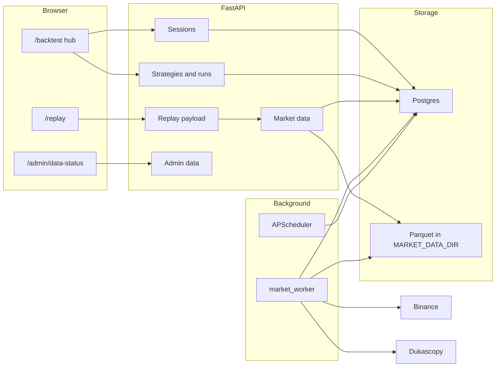

# Trade Replay and Backtesting: end-to-end guide

This is the single guide for how Trade Replay, manual sessions, and automated backtests work in TradeFix, and what you have to do yourself before they can show candles.

Setup commands in short form also live in [README_BACKTESTING.md](../README_BACKTESTING.md). Open items that still need a person or a live network are in [FINAL_REPORT.md](FINAL_REPORT.md) and [HUMAN_QA.md](HUMAN_QA.md).

## 1. The three products

They share one candle store and one set of trading rules. They do not share the live journal.

| Product | What you do | Where it lives |
|---|---|---|
| Trade Replay | Watch a trade you already logged, candle by candle, with entry, exit, stop, and target drawn on the chart | `/replay/{tradeId}` |
| Manual backtesting | Pick a symbol and a start time, play the chart forward, and place orders yourself | `/backtest` → Manual Sessions |
| Automated backtesting | Save a strategy (indicators, stop, target, costs) and let a job run it over a date range | `/backtest` → Strategies, then Runs |

A fourth tab, **Setup Lab**, is the older expectancy table from your live journal tags. It is not a candle replay.

Simulated trades (a finished manual session saved into the journal, or anything marked simulated) stay out of the dashboard, analytics, calendar, exports, and the AI assistant. Live trades stay the source of truth.

## 2. What you do from your side

You do not draw candles by hand. You start the processes, enable an instrument, and let the worker fetch history. Until that history exists, replay and sessions answer “preparing” or “that range is outside the stored data.”

### 2.1 One-time setup

From `backend/`, using the project virtualenv (`.\venv\Scripts\python.exe` on Windows):

1. Copy `backend/.env.example` to `backend/.env`. Set `DATABASE_URL` and `JWT_SECRET`. Leave `MARKET_DATA_DIR` on a disk that survives restarts. The default folder is `market_data` under the backend working directory.
2. Apply migrations: `alembic upgrade head`. Replay, sessions, strategies, and runs need the backtesting tables (through revision `0038`).
3. Install the Dukascopy downloader once, only if you want forex or metals: `npm ci --prefix tools/dukascopy`. That data is for personal use. Set `DUKASCOPY_ENABLED=false` if you are not allowed to use it.
4. Start Postgres, then the API: `uvicorn app.main:app --reload`.
5. Start the market worker in a second terminal: `python -m app.workers.market_worker`. One worker is enough. A second process takes the same Postgres lock, logs that the lock is held, and does not run jobs.
6. From `frontend/`: `npm install`, then `npm run dev`. Sign in with a normal TradeFix account.

For local development you can set `MARKET_WORKER_IN_PROCESS=true` and skip the separate worker. Production should run the worker as its own process.

### 2.2 Turn a symbol on and load candles

An instrument in `backend/app/services/marketdata/instruments.yaml` stays disabled until you verify a real day and write that result.

```text
python -m app.cli.marketdata verify-instrument BTCUSDT --write
python -m app.cli.marketdata seed-demo
python -m app.cli.marketdata coverage BTCUSDT
```

- `verify-instrument --write` fetches one recent day. If the fetch looks sane, it sets `enabled: true` and `verified_on`.
- `seed-demo` loads the previous full calendar month for BTCUSDT, EURUSD, and XAUUSD. Disabled symbols are skipped.
- `coverage` prints the stored minute ranges and gap stats.

**Right now only BTCUSDT is enabled** (Binance spot, verified 2026-10-14). EURUSD, XAUUSD, and the other forex, metal, and index symbols use Dukascopy. From this development network Dukascopy returns an AWS WAF challenge (HTTP 202). Do not try to bypass it. Those symbols stay off until `verify-instrument --write` succeeds on a network the provider serves.

To load more history after the seed month:

```text
python -m app.cli.marketdata backfill BTCUSDT --from 2024-01-01 --to 2024-04-01
python -m app.cli.marketdata top-up
```

`top-up` continues from the last covered minute up to the last fully closed UTC day. Running it twice does not duplicate rows. Skipping a night is safe: the next run fills the hole.

### 2.3 Make yourself an admin

Market-data operations (coverage page, backfill from the UI, aliases, retry) require `user.role = admin`.

```text
python -m app.cli.marketdata make-admin you@example.com
```

Sign out and back in so the app reloads your role. Then open `/admin/data-status`, or use the Market data link on the Backtesting page. A non-admin sees “Admin access is required” and the API returns 403.

### 2.4 Day-to-day use

Keep the API, the worker, and the frontend running. After that:

1. Log or import a real trade whose symbol resolves to an enabled instrument (BTCUSDT today).
2. Open the trade and choose **Replay**, or go to `/replay/{tradeId}`.
3. For a practice session: **Backtesting → Manual Sessions → New session**.
4. For a strategy: **Backtesting → Strategies → New strategy**, pick a template or build rules, then **Run backtest**.

You do not place Binance or Dukascopy orders. These features only read public history and simulate fills on that history.

## 3. Architecture



| Layer | Responsibility |
|---|---|
| Next.js pages | Replay, the backtesting hub, the session simulator, the strategy form, run results, admin data status |
| FastAPI routers | Auth, validation, and HTTP status codes. Business rules stay in services |
| Services | Candle reads, replay windows, session checks, the strategy engine, quotas |
| `market_worker` | Claims rows from the `jobs` table and runs ingestion or a backtest |
| APScheduler | Once a day, enqueues top-up and cross-check jobs. Only the process holding the scheduler lock does this |
| Postgres | Users, live trades, coverage, jobs, sessions, strategies, runs, aliases |
| Parquet + DuckDB | The candles themselves. One short-lived DuckDB query per read. Files are replaced by write-to-temp then rename so a crash does not leave a half file |

Feature flags `backtesting.replay`, `backtesting.manual`, `backtesting.automated`, and `market_data.read` exist. Every signed-in user is allowed today.

## 4. How candles get onto disk

### 4.1 Registry

`instruments.yaml` is the list of symbols the product knows. Each row has asset class, source (`binance` or `dukascopy`), pip size, contract size, quote currency, and `enabled`. Adding a symbol means adding a row, verifying it, then backfilling. The database mirror of that file is updated when the registry is loaded.

Broker names such as `BTC-USD` can be mapped to `BTCUSDT` with `add-alias` or on the admin page. Names that never resolve are counted in `unresolved_symbols` and shown under Unresolved symbols. Replay does not invent a chart for them.

Bybit, OKX, and Bitget crypto trades can replay on Binance candles for the same pair. The replay screen says prices come from Binance and may differ slightly.

### 4.2 Coverage versus files

`candle_coverage` in Postgres records half-open minute ranges that were **requested and answered**, including weekends with no ticks. The Parquet files hold the actual bars. Coverage is written only after the month file is stored. A failed download, a Dukascopy tool error, or a full disk does not mark the missing range covered.

`candle_month_stats` stores, per instrument and month, row count, gap minutes, and outlier counts. The admin coverage table reads those numbers.

### 4.3 Who fetches

| Situation | What happens |
|---|---|
| Small Binance gap, under the inline cap | The API fetches it during the request |
| Large gap, Dukascopy, or a timeout | A `candles.ingest` job is queued. The API returns HTTP 202 with code `data_preparing` and a `job_id`. The UI polls |
| You run `backfill` or `seed-demo` | The CLI fills gaps directly, or with `--enqueue` hands them to the worker |
| Nightly top-up | Scheduler enqueues `candles.topup` with dedup key `topup:YYYY-MM-DD`. A second enqueue the same day reuses that job |
| Daily cross-check | `candles.crosscheck`, key `crosscheck:YYYY-MM-DD`. It compares a stored close with a reference when one is supplied, and logs the difference against `CROSSCHECK_TOLERANCE_PCT` (default 0.1) |

The worker lanes are `binance`, `dukascopy`, and `backtest`, with separate concurrency caps. Binance is throttled (default 5 requests per second). Dukascopy is slower (default 0.5 per second) and calls the pinned `dukascopy-node` tool.

After a trade is created, imported, or synced, prefetch enqueues the replay window for that symbol if it resolves. A failure there is logged and does not fail the trade save.

### 4.4 Reading candles back

`GET /api/market-data/candles` returns arrays of time, open, high, low, close, and volume for an enabled symbol and a timeframe (`1m`, `5m`, `15m`, `30m`, `1h`, `4h`, `1d`). Higher timeframes are aggregated from stored 1-minute bars. A bounded in-memory cache holds recent windows. A repeat read of the same window is a cache hit. A top-up that rewrites the current month drops the overlapping cache entries.

Candle prices are **bid**. Spread is charged half on entry and half on exit inside the simulators. The chart itself draws the bid candles.

## 5. Trade Replay

### 5.1 What you click

On a trade detail page, or in the trade preview drawer, **Replay** goes to `/replay/{tradeId}`. The page loads only `GET /api/trades/{tradeId}/replay`. It does not put prices in the URL.

### 5.2 What the server builds

`build_replay_payload` is the one builder for journal trades, session trades, and run trades.

1. Resolve the symbol to an enabled instrument.
2. Choose a default timeframe from how long the trade was open.
3. Build a window: about 200 bars before entry and 100 bars after exit, in 1-minute data, padded so the chart has context. The playhead is suggested 100 bars before entry.
4. Call `ensure_candles` for that window.
5. If candles are already stored, status is `ready` and the payload includes an alignment check.
6. If a fetch was queued, status is `preparing` and `job_id` is set. The page shows “Preparing market data” and polls until the job finishes.

Alignment compares your entry and exit prices with the candle high and low. Tolerance is the larger of `REPLAY_ALIGNMENT_TOLERANCE_PIPS` (default 2) and `REPLAY_ALIGNMENT_TOLERANCE_PCT` (default 0.05 percent of price). If the price sits outside the candle, the page can show a banner. Shifting the chart for display does not change the stored trade.

### 5.3 Time basis

Journal times are not always UTC. Each account can have a detected offset (`account_time_offsets`) from comparing logged prices with candles. The basis is one of `utc_aware`, `naive_wall_clock`, or `unknown`.

You can run detection yourself:

```text
python -m app.cli.marketdata detect-offsets
python -m app.cli.marketdata offsets-report
```

The admin page lists the same report at `GET /api/admin/time-offsets`. Session and run replays are stored as `utc_aware` because those clocks are the candle clock.

### 5.4 What the browser does

The chart is TradingView Lightweight Charts, loaded only inside `frontend/components/chart/lightweightBackend.ts`. The footer links to Lightweight Charts and to `/notices`.

The replay engine (`frontend/lib/backtest/replayEngine.ts`) keeps a history buffer, a forward buffer of 1-minute candles, and one forming candle. You only see minutes with time before the cursor. Play, pause, speed, step one minute, step one candle, and seek all go through that engine. It will not rewind while a manual session has an open position or a pending order. Journal replay can step backward.

Notes you add are `POST /api/trades/{tradeId}/replay-notes` and are stored against that journal trade.

## 6. Manual backtesting

### 6.1 Setup

**Backtesting → Manual Sessions → New session** (`/backtest/sessions/new`).

You choose an enabled instrument, a start time inside stored coverage, a timeframe, starting balance, currency, spread in pips, and commission per lot. The start must fall inside a covered range. Balance must be greater than zero. You can keep up to `BACKTEST_MAX_SESSIONS` sessions (default 50). New sessions also count against `BACKTEST_RUNS_PER_DAY` (default 30) for that calendar day.

`POST /api/backtest/sessions` creates the row. The browser then opens `/backtest/sessions/{id}`.

### 6.2 The simulator

The page starts the same replay engine at your cursor. The order ticket is local until it is saved:

- Buy or sell, market, limit, or stop.
- Size as a fixed amount, or from risk percent and a stop distance.
- Stop and target in price, pips, or R. In R mode the stop distance is still entered in pips, and the target is that many R away.

**Market orders fill at the open of the next candle**, not at the click. When one candle can hit both the stop and the target, the stop wins. A gap through a level fills at the open. Slippage applies to market and stop fills, including the stop loss and a manual close. Take-profit and “session end” closes do not slip. Half the spread is still charged on the way out.

One position at a time. A pending order does not trigger while a position is open.

The book autosaves on pause, every 15 seconds while playing, and when the tab hides:

- `PUT /api/backtest/sessions/{id}/state` for the cursor and notes
- `POST .../orders` and `POST .../trades` with client UUIDs

The first payload for an id wins, so a retry does not duplicate the trade. The server recomputes pips, R, profit, and commission. If your client numbers disagree by more than half a cent, the row is flagged `discrepancy` and the server numbers are kept. A fill that is not inside the bid candle, after allowing half the spread, is rejected.

### 6.3 Finish and replay

**Finish** asks you to confirm, pauses, closes any open position at the last close with reason `session end` (no slippage), saves, then `POST .../finish`. The summary shows net profit, balance, win rate, expectancy in R, and an equity curve.

Each closed trade links to `/replay/session/{sessionId}/{tradeId}`. That page loads only `GET /api/backtest/sessions/{sessionId}/trades/{tradeId}/replay`. The URL carries ids, not prices. Another user’s id returns 404.

There is also `POST .../trades/{tradeId}/journal`, which copies the simulated trade into the journal with `is_simulated = true` and `time_basis = utc_aware`. It still does not appear in live analytics.

Rename (active sessions) and delete are on the session list. Delete cascades orders and trades.

## 7. Automated backtesting

### 7.1 The strategy

**Backtesting → Strategies → New strategy** (`/backtest/strategies/new`).

The form is the strategy. It is schema version 1. Unknown fields are rejected. Sections:

- Name and description
- Market: symbol, timeframe, start, end. The whole range must sit inside one covered interval, and the estimated bar count must be under `BACKTEST_MAX_BARS_PER_RUN` (default 500,000)
- Direction: long, short, or both
- Entry rules: All/Any groups of conditions. A condition is left operand, operator, right operand. Operands are price, an indicator, or a constant
- Stop and target
- Filters: UTC hours, weekdays (0 = Monday), minimum bars between entries
- Risk: starting balance, and either a fixed size or a risk percent
- Costs: spread, commission per lot, slippage

Indicators: SMA, EMA, RSI (Wilder), MACD, ATR (Wilder), Bollinger (population deviation), Stochastic, ADX, highest high, lowest low. Warm-up values are empty. Periods must sit between `INDICATOR_PERIOD_MIN` (2) and `INDICATOR_PERIOD_MAX` (500). At most `STRATEGY_MAX_CONDITIONS` (10) conditions and `STRATEGY_MAX_INDICATORS` (6) indicators.

Three templates only fill the form. They are not saved until you click Save or Run:

- Moving-average crossover: SMA(20) crosses above SMA(50)
- RSI mean reversion: RSI(14) crosses below 30
- Bollinger breakout: close crosses above the upper band

While you edit, the form posts the definition to `POST /api/strategies/validate` after a short pause. The response is always HTTP 200 and includes `ok`, field errors, and `estimated_bars`. Save and update refuse an invalid definition with code `invalid_strategy`.

You can keep `BACKTEST_MAX_STRATEGIES` strategies (default 50).

### 7.2 The run

**Run backtest** saves the strategy, then `POST /api/backtests` with `{ "strategy_id": "..." }`. You can also post a definition directly.

The server:

1. Validates again.
2. Refuses if you already have a queued, running, or waiting-for-data backtest (`BACKTEST_MAX_CONCURRENT_PER_USER`, default 1) or if today’s counter is at `BACKTEST_RUNS_PER_DAY`.
3. Hashes the definition plus symbol, timeframe, and range. If you already have a **succeeded** run with that hash inside `BACKTEST_CACHE_WINDOW_HOURS` (default 24), it copies the metrics and equity and returns immediately. It does not copy the trade rows.
4. Otherwise it inserts a `backtest_runs` row and a `backtest.run` job on the `backtest` lane.

The worker then:

1. Reports progress: loading, indicators, simulation, done.
2. Stops if you cancel, if the range is over the bar cap, or if `BACKTEST_TIME_LIMIT_S` (default 120) is exceeded.
3. Loads stored candles for the strategy timeframe, including indicator warm-up, and runs `run_strategy`. Warm-up bars cannot open a trade. If the 1-minute range is missing, the run shows **Waiting for market data** until the ingest job finishes, then continues. If the provider fails, the wait exceeds 30 minutes, or fewer bars come back than the warm-up plus 50, the run fails with a message. It does not finish empty.
4. Writes metrics, a downsampled equity curve (at most `BACKTEST_EQUITY_POINTS`, default 1,000), warnings, and trades in one transaction.

The run page polls every 2 seconds while status is `queued`, `running`, or `waiting_data`. **Cancel** sets the job’s cancel flag. A queued job, including one waiting for market data, is cancelled immediately. A running job stops at the next progress check.

### 7.3 How a strategy trades

Signals use only bars up to the one being closed. The engine accepts the order at the end of that bar, so a market order fills at the **next** open. Stop and target distances are measured from the signal bar’s close.

The same bar order as the manual simulator applies: fill queued markets, trigger pending orders, stop before target, then closes requested on this bar, then new actions.

While a position or a pending order exists, a new entry is ignored. If `exit_on_opposite` is on, an opposite signal closes and can reverse. `max_bars` can force a close. Anything still open at the last bar closes at that close with reason `end of data` and no slippage.

Size is `fixed_size`, or `risk_percent` of balance divided by the stop distance. Crypto size is in base units. Other markets convert units with `contract_size`.

Pips are direction times (exit − entry) divided by pip size. R is price profit divided by the initial risk. No stop means R is empty and the warning `no_stop` is recorded. Quote USD or USDT against an account in USD or USDT converts one to one, and commission (per lot, both sides) is subtracted. If a conversion rate is set, profit is quote times rate, minus commission. If there is no rate, profit stays in the quote currency, commission is not subtracted, and the warning is `conversion_unavailable`.

Warnings always include “past performance does not predict future results.” Extra warnings cover fewer than 30 trades, a very high win rate on a small sample, zero spread and slippage, and a range shorter than three months.

### 7.4 Results and replay

A finished run shows net profit, return, trade count, win rate, profit factor, expectancy in R, max drawdown, and average R, plus equity, drawdown, weekday and hour profit, a monthly change grid, an R histogram, and a virtualized trades table. Filters are side and exit reason. The table pages from `GET /api/backtests/{id}/trades`.

**Open** on a row goes to `/replay/run/{runId}/{seq}`, which loads only `GET /api/backtests/{runId}/trades/{seq}/replay`. Another user, or a missing sequence, is 404.

**Run again** queues another run of the same saved strategy. **Edit strategy** returns to the form. **Delete** removes the run and its trades.

## 8. Shared trading rules

Python (`backend/app/services/backtest/rules.py`) and TypeScript (`frontend/lib/backtest/orderEngine.ts`) implement the same bar order and the same costs. They are locked together by JSON scenarios in `fixtures/backtesting/scenarios/`. Both suites must agree before a release.

| Rule | Behavior |
|---|---|
| Candle | Bid |
| Market fill | Next bar’s open |
| Spread | Half on entry, half on exit, worsening the price |
| Slippage | Adverse, on market and stop fills, including stop loss and manual close |
| No slippage | Take profit, session end, end of data |
| Same candle hits stop and target | Stop wins |
| Gap through a level | Fill at the open |
| Position | One open position. Pending orders wait |

## 9. Jobs, the worker, and the scheduler

The `jobs` table is the queue for candle fetches and backtests. It is separate from broker sync jobs.

A job has a type, a lane, a status (`queued`, `running`, `succeeded`, `failed`, `cancelled`), a payload, an optional dedup key, progress, attempts, and a lock expiry. The worker claims with `SKIP LOCKED`. If a worker dies, `recover_expired` requeues a running job whose lock has passed, or marks it failed when attempts are used up. Cancel requested during a crash is stored as cancelled.

Run the worker:

```text
python -m app.workers.market_worker
```

It holds `pg_try_advisory_lock` on `MARKET_WORKER_LOCK_KEY` (default 740001) for its whole life. Heartbeats land in `worker_heartbeats`.

The API process also starts APScheduler when `ENABLE_SCHEDULER` is true. `start_scheduler` holds `SCHEDULER_LOCK_KEY` (default 740002). If another process already holds it, this process does not start a second scheduler. The scheduler still runs the existing agent, reminder, and broker jobs, and adds:

- top-up at `TOPUP_UTC_HOUR`:`TOPUP_UTC_MINUTE` (default 00:35 UTC)
- cross-check 20 minutes later

You can run top-up immediately with `python -m app.cli.marketdata top-up`.

Structured log lines include `ingest job done`, `scheduled job enqueued`, `top-up finished`, `cross-check finished`, and `backtest finished`, with job id and symbol or run id on the log record.

## 10. Admin page

`/admin/data-status` is for you after `make-admin`.

| Block | What it shows | API |
|---|---|---|
| Coverage | Symbol, source, enabled, covered from/to, row count, gap minutes, last update | `GET /api/admin/data-status` |
| Failed jobs | Type, error code, message, Retry | `POST /api/admin/jobs/{id}/retry` |
| Backfill | Instrument and a datetime range | `POST /api/admin/backfill` |
| Aliases | Broker raw symbol → canonical | `GET/POST/DELETE /api/admin/aliases` |
| Unresolved | Broker symbols that never resolved, with counts | `GET /api/admin/unresolved` |
| Time offsets | Detected account timezone, confidence, match rate, sample size | `GET /api/admin/time-offsets` |

Retry only requeues a **failed** job, and it will not create a second active job with the same dedup key.

## 11. Screens and APIs

| You open | The page calls |
|---|---|
| `/replay/{tradeId}` | `GET /api/trades/{id}/replay`, notes on `/api/trades/{id}/replay-notes` |
| `/replay/session/{sessionId}/{tradeId}` | `GET /api/backtest/sessions/{sessionId}/trades/{tradeId}/replay` |
| `/replay/run/{runId}/{seq}` | `GET /api/backtests/{runId}/trades/{seq}/replay` |
| `/backtest` | Session list, strategy list, run list, Setup Lab |
| `/backtest/sessions/new` | `GET /api/market-data/instruments`, `POST /api/backtest/sessions` |
| `/backtest/sessions/{id}` | Session GET, state, orders, trades, finish |
| `/backtest/strategies/new` and `/backtest/strategies/{id}` | `POST /api/strategies/validate`, strategy CRUD, `POST /api/backtests` |
| `/backtest/runs/{id}` | `GET /api/backtests/{id}`, trades, cancel, delete |
| `/admin/data-status` | Admin routes in the table above |
| `/notices` | Static attribution. No API |

Chart data for replay and the simulator also uses `GET /api/market-data/candles`. Job progress for a preparing replay uses `GET /api/market-data/jobs/{jobId}`.

Common error codes: `instrument_not_supported` and `invalid_strategy` and `range_outside_available_data` are 422, `data_preparing` is 202, `quota_exceeded` and `rate_limited` are 429, `not_found` is 404, `data_unavailable` is 503.

## 12. What is true today, and what is not

True:

- BTCUSDT can be verified, seeded, replayed, and used in a session or a strategy when the worker has stored that range.
- Journal, session, and run replay share one payload builder and one chart.
- Python and TypeScript fill rules match on the shared scenarios.
- A 100,000-bar strategy run on the development machine finished in 0.48 seconds. The cap for that check is 10 seconds.
- Live journal numbers ignore simulated trades.

Not true yet, or still waiting on you:

- EURUSD and XAUUSD are not enabled until Dukascopy verification succeeds.
- ATR stops, swing stops, and ATR targets use a pip-sized offset. They are not a true ATR or swing calculation.
- `max_trades_per_day` is saved on the strategy and is not enforced while the engine steps.
- The 20-user candle load test (`backend/scripts/load_test_candles.py`) has not been run against a live API.
- Browser checks in `HUMAN_QA.md` (chart lifecycle, replay states, a full manual session, the three strategy templates, the admin page, a fresh checkout) are still for you to tick.

## 13. If something looks wrong

| What you see | What to check |
|---|---|
| Replay says the symbol is not supported | The broker symbol has no alias, or the instrument is still `enabled: false`. Run `verify-instrument SYMBOL --write` after a good fetch |
| Replay stays on Preparing | The worker is not running, or the provider is failing. Open `/admin/data-status` and read Failed jobs |
| Session create says the range is outside stored data | `coverage SYMBOL`. Seed or backfill that start time, then try again |
| Strategy validate says the range is too long | Shorten the dates or raise `BACKTEST_MAX_BARS_PER_RUN` |
| Second backtest returns 429 | You already have one queued or running, or you hit today’s run cap. Cancel the active run, or wait until the next UTC day for the daily counter. The cache window only skips work when a previous run **succeeded** |
| Admin page says access is required | `make-admin`, then sign in again |
| Forex candles never arrive | Dukascopy WAF on this network. BTCUSDT via Binance is the path that works here |
| Dashboard profit includes a practice trade | It should not. Practice trades are `is_simulated`. If one appears, that is a bug in a reader that bypassed `live_trades` |
