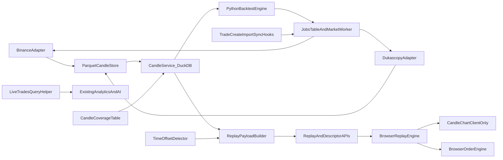

# Backtesting: Phased Implementation Plan (revision 2)

Canonical plan for Trade Replay, Manual Backtesting and Automated Backtesting. Behaviour is defined by the spec pack in this folder (`00` to `05`). This file defines **order, scope, gates and handoff**.

Companion files (all in `backtesting/`):

- `PROGRESS.md` is the single resume file: current sub-phase, ticks, files changed, commands run, pending human items.
- `DECISIONS.md` holds numbered decisions and conflict resolutions (D-001 onward).
- `AUDIT.md` holds codebase facts (written in Phase 0).
- `HUMAN_QA.md` holds every check that needs a person, grouped by phase, with checkboxes.

---

## 1. Handoff protocol

1. Every sub-phase fits in one context window. Sizing rule (D-014): at most about 8 files touched, and never backend and UI in the same sub-phase.
2. A new context window reads `PROGRESS.md`, `DECISIONS.md` and `AUDIT.md`, then **only** the "Read first" sections of the current sub-phase.
3. At the end of a sub-phase, do the following:
   - Tick its checklist in `PROGRESS.md`.
   - List the files changed and the exact verification commands with their output summary.
   - Add any NEEDS-NETWORK or NEEDS-HUMAN items to the "Pending human verification" table.
   - Make one git commit (D-016), then stop.
4. Spec changes go into the matching spec file plus a DECISIONS entry. Never keep them only in chat.

**Bootstrap prompt** for a new context window:

```text
Continue the TradeFix Backtesting build. Read backtesting/PROGRESS.md, backtesting/DECISIONS.md
and backtesting/AUDIT.md. Then read only the "Read first" sections of the current sub-phase in
backtesting/PLAN.md. Complete that sub-phase, run its AUTOMATED gate checks, record NEEDS-NETWORK
and NEEDS-HUMAN items as pending in PROGRESS.md, commit, and stop.
```

## 2. Gate honesty (D-015)

Every gate check carries one label:

- **[AUTO]**: the agent runs it. It may be ticked only if the agent actually ran it and saw it pass. Paste the command and its result summary into PROGRESS.md.
- **[NET]**: needs live provider calls. The agent attempts it if network is available. If it fails because of network or region issues, record it as "pending human verification" with the exact command.
- **[HUMAN]**: browser QA, visual checks, or spreadsheet comparison. It is always recorded as pending and listed in `HUMAN_QA.md`. The agent never ticks it.

Rules:

- A sub-phase may start once the previous sub-phase's **[AUTO]** checks pass.
- A phase gate (Gate 1 to Gate 4, Final) is reported as **"automated checks passed, N human items pending"** until the user ticks the matching HUMAN_QA items. Never write "gate passed" while items are pending.
- The final report lists every pending item.

## 3. Commit and migration rules (D-016)

- One commit per sub-phase, with message `backtesting(<id>): <short scope>`, for example `backtesting(1f): jobs queue and market worker`.
- Stage only files this sub-phase touched, with `git add <paths>`, never `git add -A`. Unrelated work in the tree must not be swept in.
- Every migration gets an **[AUTO]** round-trip check: `alembic upgrade head`, then `alembic downgrade -1`, then `alembic upgrade head`. It also gets a pytest that asserts the tables and columns exist after upgrade and are gone after downgrade.
- Migration ids continue the numeric chain from `0032`:
  - `0033` market data plus the `trades` columns
  - `0034` account time offsets
  - `0035` replay notes
  - `0036` sessions
  - `0037` strategies and runs

## 4. Architecture



**Backend modules.** Routers stay thin, with no business logic.

- Models: `app/models/market_data.py`, `app/models/job.py`, `app/models/backtest.py`, `app/models/time_offset.py`
- `app/services/live_trades.py`: the only way existing code queries journal trades (D-005)
- `app/services/marketdata/`:
  - `instruments.yaml`, `registry.py`, `resolver.py`, `time_offsets.py`, `validation.py`
  - `store.py`, `coverage.py`, `aggregation.py`, `candle_service.py`, `cache.py`
  - `replay_service.py`, `prefetch.py`, `topup.py`
  - `providers/{base,binance,dukascopy}.py`
- `app/services/jobs/{queue,runner,provider_limiter,locks}.py`
- `app/services/backtest/`:
  - `entitlements.py`, `quotas.py`, `errors.py`
  - `rules.py`, `indicators.py`, `strategy_schema.py`, `engine.py`, `metrics.py`, `downsample.py`
  - `sessions_service.py`, `runs_service.py`
- `app/api/routers/{market_data,replay,backtest_sessions,strategies,backtests,admin_data}.py`
- `app/workers/market_worker.py`
- `app/cli/marketdata.py`, run as `python -m app.cli.marketdata <cmd>`
- `backend/tools/dukascopy/` holds the pinned `dukascopy-node`

**Frontend modules**

- `lib/backtest/`: pure TypeScript with no React imports (`types`, `timeframes`, `replayEngine`, `orderEngine`, `rules`, `stats`, `rng`)
- `lib/hooks/`: `useCandles`, `useReplay`, `useBacktestSessions`, `useStrategies`, `useBacktestRuns`, `useDataStatus`
- `components/chart/CandleChart.tsx`: the only importer of lightweight-charts; client-only (D-024)
- `components/replay/`, `components/backtest/{session,strategy,results}/`, `components/admin/data-status/`
- Routes:
  - Replay: `app/(app)/replay/[tradeId]`, `app/(app)/replay/session/[sessionId]/[tradeId]`, `app/(app)/replay/run/[runId]/[seq]` (D-021)
  - Backtesting: `app/(app)/backtest` (the hub), with `sessions/new`, `sessions/[id]`, `strategies/new`, `strategies/[id]`, `runs/[id]`
  - Admin: `app/(app)/admin/data-status`

**Shared test assets:** `fixtures/backtesting/scenarios/*.json`, `fixtures/backtesting/scenario-format.md` (D-025).

---

## 5. Sub-phases

Each sub-phase has these parts: Scope, Read first, Files, Tasks, Gate. Gate labels are explained in section 2.

### Phase 0: Audit and docs

- **Scope:** write AUDIT.md and confirm this plan. No feature code.
- **Read first:** all of `00` to `05`; this file; DECISIONS.md.
- **Files:** `backtesting/AUDIT.md`, `PROGRESS.md`
- **Tasks:**
  1. Record backend and frontend stack facts (the base list is in DECISIONS.md "Audit snapshot").
  2. Record the development OS: Windows 10/11 (win32 10.0.26300), PowerShell shell, and the likely Linux deploy target (D-020).
  3. Trade time basis per write path:
     - Manual create: what the frontend form sends (ISO with offset or a naive value).
     - Legacy CSV, file import confirm, and broker sync: the time basis of each provider. Which providers return true UTC epochs and which return broker server time, for example MT4/MT5.
     - Record the results in a table; they feed D-013 and D-022.
  4. User profile timezone field: where it is stored and its format.
  5. Confirm Node.js is available (`node --version`) for Dukascopy.
  6. Confirm local Postgres is reachable for integration tests and migration round trips.
- **Gate:**
  - [AUTO] AUDIT.md exists and covers tasks 1 to 6.
  - [AUTO] `node --version` and a Postgres connect check were run, and their output is recorded.

### Phase 1A: Schema, config, registry

- **Scope:** dependencies, settings, the first migration, and the instrument registry.
- **Read first:** 01 section 6 (limits); 02 sections 1 and 2; 03 section 2 (instruments, symbol_aliases, unresolved_symbols, candle_coverage, jobs).
- **Files:**
  - `requirements.txt` (add `numpy`, `pyarrow`, `duckdb`)
  - `core/config.py`, `.env.example`
  - `models/market_data.py`, `models/job.py`, `models/trade.py`
  - `alembic/versions/0033_market_data.py`
  - `services/marketdata/instruments.yaml`, `services/marketdata/registry.py`
  - The startup mirror hook in `main.py`
- **Tasks:**
  1. Add every limit from 01 section 6, 02 and this plan as settings, with defaults, and document each one in `.env.example`.
  2. Migration `0033` creates:
     - The tables `instruments`, `symbol_aliases`, `unresolved_symbols`, `candle_coverage` and `jobs`. The jobs dedup key is a partial unique index while status is queued or running.
     - `trades.is_simulated` (boolean, default false, indexed).
     - `trades.time_basis` (D-022), backfilled from `source` using the AUDIT table.
  3. Write `instruments.yaml` with the full seed list. Every entry has `enabled: false` and `verified_on: null` until it is verified (D-027).
  4. `registry.py` validates the YAML with pydantic and mirrors it into the `instruments` table at startup, idempotently.
- **Gate:**
  - [AUTO] The 0033 migration round trip passes.
  - [AUTO] Registry tests pass: valid YAML loads, invalid YAML is rejected, and the mirror is idempotent.
  - [AUTO] The existing backend test suite still passes.

### Phase 1B: Live-trades helper, core journal readers

- **Scope:** create the central helper and route the journal and analytics readers through it (D-005).
- **Read first:** DECISIONS D-005; AUDIT section "Trade readers".
- **Files:**
  - `services/live_trades.py`, `stats_service.py`, `dashboard_analytics.py`, `advanced_analytics/__init__.py`, `trade_export.py`
  - `api/routers/trades.py`, `analytics.py`, `accounts.py`
  - New tests
- **Tasks:**
  1. Grep every reader of `Trade` rows, including `select(Trade)`, `query(Trade)`, raw SQL, and `.trades` relationships. About 21 files were found in revision 2. Write the full list into AUDIT.md with a group (core or AI/sync) for each.
  2. `live_trades.py` exposes two things:
     - `live_trades_query(user_id, *, include_deleted=False)`, which always applies `is_simulated = false`.
     - `LIVE_TRADE_FILTER`, for joins.
  3. Route the core readers through the helper: analytics, dashboard, advanced analytics, trade lists, the calendar and day view, exports, tags and notes, checkins, recaps, progress tracker, prop, behavior, insight rules, and tradefix score.
  4. Add a regression test per reader that inserts one `is_simulated` trade and asserts it never appears.
- **Gate:**
  - [AUTO] The per-reader exclusion tests pass.
  - [AUTO] The existing test suite passes unchanged.

### Phase 1C: Live-trades helper, AI, sync, import and raw-SQL readers

- **Scope:** the remaining readers, plus a "results unchanged" proof.
- **Read first:** D-005; the AUDIT reader list.
- **Files:**
  - `services/ai/agents/context.py`, `ai/tools/analytics.py`, `ai/insights/engine.py`, `ai/insights/snapshot.py`, `ai/rag/ingest.py`
  - `ingestion/persist.py`, `brokers/connections.py`, `imports/duplicates.py`, `imports/confirm.py`
  - Tests (this is slightly over the 8-file rule, but every edit is a one-line route-through)
- **Tasks:**
  1. Route the AI SQL and tool queries and the RAG ingest through the helper. Simulated trades must never be embedded or retrieved.
  2. Broker-sync matching and import dedup must ignore simulated trades. A simulated trade must never be matched as the existing row for a broker position.
  3. Add any raw SQL found to the helper's filter.
  4. Add a golden "unchanged results" test. It runs the analytics summary, the dashboard, advanced analytics and an AI analytics tool on a fixed non-simulated dataset, before and after a simulated trade is inserted, and asserts the outputs are identical.
- **Gate:**
  - [AUTO] The per-reader tests pass.
  - [AUTO] The unchanged-results test passes.
  - [AUTO] The full suite passes.

### Phase 1D: Resolver, validation, store, coverage

- **Scope:** symbol resolution, candle validation, the Parquet store, and coverage math.
- **Read first:** 02 sections 1, 3.1, 3.2, 4, 5 and 8; D-020.
- **Files:**
  - `marketdata/resolver.py`, `validation.py`, `store.py`, `coverage.py`
  - Four test files
- **Tasks:**
  1. Resolver: alias lookup, then suffix and separator rules, then crypto perpetual naming, then the unresolved counter. Symbol resolution only; time handling lives in Phase 2A.
  2. Validation: candle rules, monotonic and aligned timestamps, dedup keeps the later fetch, outlier flags, and a gap summary for open-market periods.
  3. Store:
     - An interface plus a local Parquet implementation (zstd, one sorted file per instrument-month).
     - Writes go to a temp file on the same filesystem, then replace atomically with `os.replace`. A `PermissionError` is retried with backoff (5 attempts, 50 ms doubling).
     - A per-instrument-month lock.
     - Reads open a new in-memory DuckDB connection **per query**, pass an explicit file list, and close it immediately. No long-lived handles (D-020).
  4. Coverage: gaps, mark covered (only after a successful write), and merging of adjacent and overlapping ranges.
- **Gate:**
  - [AUTO] Resolver tests pass: aliases, broker suffixes, separators, perpetuals, and the unresolved counter.
  - [AUTO] Validation tests pass.
  - [AUTO] Store tests pass:
    - A crash between the temp write and the replace leaves the old file intact.
    - A simulated `PermissionError` is retried and then succeeds.
    - The dedup merge works.
    - Concurrent writers are serialized.
    - The file can be replaced while a read has just finished.
  - [AUTO] Coverage tests pass.

### Phase 1E: Provider adapters

- **Scope:** Binance and Dukascopy adapters, recorded fixtures, and the verify-instrument command.
- **Read first:** 02 sections 6 and 7; 05 section 2; D-009, D-027.
- **Files:**
  - `providers/base.py`, `providers/binance.py`, `providers/dukascopy.py`
  - `backend/tools/dukascopy/package.json` plus its lockfile
  - `tests/fixtures/marketdata/*`, `tests/test_providers.py`
  - `app/cli/marketdata.py` (created here with `verify-instrument`)
- **Tasks:**
  1. Binance bulk mode:
     - Monthly and daily archives, with checksum verification.
     - Millisecond vs microsecond timestamp detection.
     - A 404 falls back to REST.
  2. Binance REST mode:
     - Pages through klines and paces itself by the usage headers.
     - Backs off on 429 and 418, honouring retry-after; tries the alternate host on 451.
     - Keeps only closed candles.
  3. Dukascopy:
     - A pinned `dukascopy-node` subprocess fetching 1-minute BID candles in UTC, without flat candles, in one-week chunks.
     - Output is validated.
     - Behind `DUKASCOPY_ENABLED`.
  4. Add recorded fixtures for every case in 05 section 2.
  5. `verify-instrument <symbol>` fetches one real recent day and checks:
     - The row count is plausible.
     - Prices are within broad sanity ranges.
     - Validation passes.
     With `--write`, it sets `verified_on` and `enabled: true` in the YAML.
- **Gate:**
  - [AUTO] Adapter unit tests pass on fixtures: both timestamp units, a checksum mismatch, 429, 451, malformed Dukascopy output.
  - [NET] Live smoke: `pytest -m live tests/test_providers.py`.

### Phase 1F: Jobs, worker, entitlements, errors

- **Scope:** the job queue and worker runtime. This was revision 1's "Phase 1C" first half.
- **Read first:** 02 section 10; 01 sections 6 and 9; 03 sections 1 and 10; D-002, D-019, D-026.
- **Files:**
  - `services/jobs/queue.py`, `provider_limiter.py`, `locks.py`
  - `workers/market_worker.py`
  - `services/backtest/entitlements.py`, `services/backtest/errors.py`
  - `api/deps.py` (`require_admin`), `main.py` (error handler)
  - `cli/marketdata.py` (`make-admin`)
- **Tasks:**
  1. The queue:
     - Enqueue with a dedup key.
     - Claim with `SELECT ... FOR UPDATE SKIP LOCKED`, setting `locked_by` and `locked_until`.
     - Recover expired locks.
     - Retry with exponential backoff and jitter, up to `max_attempts`.
     - Support cancellation, checked between chunks.
     - Update progress.
  2. A global token-bucket rate limiter per provider, plus per-type concurrency limits (1 Dukascopy, 2 Binance, 2 backtest jobs).
  3. `market_worker` takes `pg_try_advisory_lock(MARKET_WORKER_LOCK_KEY)` on a dedicated connection. If the lock is not acquired, it logs and idles (D-019). It writes a heartbeat row and offers an in-process option behind a flag.
  4. `check_feature(user, key)` allows everyone for now. `BacktestError(code, message, status)` gets a JSON handler that returns the stable codes.
  5. `require_admin` checks `user.role == "admin"`. `make-admin <email>` grants the role (D-026).
- **Gate:**
  - [AUTO] Job tests pass: dedup, retry/backoff, lock-expiry recovery, cancellation, per-provider concurrency, and a second worker being denied the advisory lock.
  - [AUTO] Error-handler shape test passes.
  - [AUTO] `make-admin` test passes.

### Phase 1G: Candle service core

- **Scope:** `ensure_candles`, `get_candles`, aggregation and cache. Backend services only.
- **Read first:** 02 section 9; D-017.
- **Files:**
  - `marketdata/candle_service.py`, `aggregation.py`, `cache.py`
  - Tests for each
- **Tasks:**
  1. `ensure_candles` (D-017):
     - Dukascopy instruments always go through a job.
     - An inline fill is allowed only for Binance REST, only for gaps up to `INLINE_FETCH_MAX_GAP_MINUTES` (default 4,320), and only within `INLINE_FETCH_TIMEOUT_S` (default 8).
     - A global semaphore of `INLINE_FETCH_MAX_CONCURRENT` (default 4) caps inline fetches. Over the cap, or on timeout, the request is enqueued as a deduplicated job and returns "preparing" with the job id.
  2. `get_candles`:
     - Reads 1m directly; aggregates higher timeframes in DuckDB on UTC boundaries for 1m to 1d.
     - Applies the completeness rule with the `until` cutoff.
     - Enforces the bar cap, and returns has-more flags and the earliest-available time.
  3. Cache: a bounded LRU; a top-up invalidates the current month's entries.
- **Gate:**
  - [AUTO] Aggregation tests pass for 5m, 15m, 1h, 4h and 1d against an independent pure-Python calculation on fixture data. Incomplete buckets are excluded.
  - [AUTO] `ensure_candles` tests pass with mocked providers:
    - No gap: returns instantly.
    - A small Binance gap is fetched inline.
    - A Dukascopy gap always becomes a job.
    - Over the concurrency cap: becomes a job.
    - Timeout: becomes a job.
    - Many concurrent callers produce exactly one job.
    - A provider failure leaves coverage unchanged.
  - [AUTO] Cache invalidation test passes.

### Phase 1H: Candle API, health, gzip, CLI, seed (Gate 1)

- **Scope:** expose the data, the operating commands, and the Phase 1 gate. This was revision 1's "Phase 1C" second half.
- **Read first:** 02 sections 13 to 15; 03 sections 3.1 and 3.5 (health); 05 section 3; D-018, D-027.
- **Files:**
  - `schemas/market_data.py`, `api/routers/market_data.py`
  - `main.py` (router, gzip, health)
  - `cli/marketdata.py` (remaining commands)
  - `tests/test_candle_api.py`
- **Tasks:**
  1. Endpoints:
     - `GET /api/market-data/instruments`
     - `GET /api/market-data/candles`, which returns columnar arrays in epoch milliseconds, is rate limited per user, and returns 202 with `data_preparing` and a job id when data isn't ready
     - `GET /api/market-data/jobs/{id}`
  2. Extend `/api/health` with database, storage-writable and worker-heartbeat checks.
  3. GZip (D-018): add `GZipMiddleware(minimum_size=1024)`. Verify that the CSV `StreamingResponse` downloads still stream and complete:
     - `analytics.py` line 174
     - `accounts.py` line 258
     - the trade export
     Also verify that `/ws/account` still works. On any failure, restrict gzip to `/api/market-data` with a path-scoped middleware and record that in D-018.
  4. The remaining CLI commands: `seed-demo`, `backfill`, `top-up`, `coverage`, `verify`, `add-alias`, `unresolved`.
  5. Provider verification (D-027): `verify-instrument --write` for BTCUSDT, EURUSD and XAUUSD.
- **Gate 1:**
  - [AUTO] Candle API tests pass: authentication is required, rate limiting works, the limits apply, the response shape is correct, gzip is active, and the preparing response is polled.
  - [AUTO] Streaming tests pass: the CSV exports return full bodies with gzip on, and a WebSocket connection test passes.
  - [AUTO] Idempotency: running the same fixture-provider backfill twice gives identical files and row counts.
  - [NET] `python -m app.cli.marketdata verify-instrument BTCUSDT EURUSD XAUUSD --write` succeeds.
  - [NET] `python -m app.cli.marketdata seed-demo` loads one month for all three. Expected row counts: crypto about 43,000 to 44,640, forex about 28,000 to 32,000. `coverage` shows no unexplained gaps.
  - [NET] The candle API returns correct aggregated candles for all timeframes on the seeded data (run `pytest -m seeded`).
  - [NET] Cross-check the BTCUSDT and EURUSD daily closes against a reference, within tolerance.

### Phase 2A: Trade time-offset detection

- **Scope:** decide each account's time basis from evidence (D-013, D-022, D-023). Backend only.
- **Read first:** 02 section 3.3; D-013, D-022, D-023; AUDIT "time basis" table.
- **Files:**
  - `models/time_offset.py`, `alembic/versions/0034_account_time_offsets.py`
  - `marketdata/time_offsets.py`
  - `cli/marketdata.py` (`detect-offsets`, `offsets-report`)
  - `api/routers/admin_data.py` (created here with `GET /api/admin/time-offsets`)
  - `tests/test_time_offsets.py`
- **Tasks:**
  1. Table `account_time_offsets`: `user_id`, `account_id`, `broker_account_id` (nullable), `tz_kind` (iana or fixed), `tz_value`, `confidence` (high, medium, low, unknown), `match_rate`, `sample_size`, `runner_up`, `computed_at`, `method`.
  2. Candidate offsets:
     - UTC
     - The user's profile timezone
     - `Etc/GMT-2`, `Etc/GMT-3`
     - New York close with DST (`America/New_York` plus 7 hours, meaning EET/EEST)
     - Common fixed offsets, from the config list `TIME_OFFSET_CANDIDATES`
  3. Detection only runs on an account's trades whose `time_basis` is `naive_wall_clock` or `unknown`, and only when stored candles cover their entry minutes. It never triggers a fetch.
  4. Scoring: for each candidate, reinterpret the stored wall time and count the trades whose entry price falls inside the 1m candle's range, within the alignment tolerance.
     - Pick the candidate with the best match rate.
     - Confidence comes from the match rate, the margin over the runner-up, and the sample size. With fewer than `TIME_OFFSET_MIN_SAMPLE` trades (default 5), confidence is `unknown`.
  5. `effective_utc(trade)` applies these rules in order:
     - If `time_basis` is `utc_aware`, use the value as UTC.
     - Otherwise use the account's detected offset if its confidence is medium or above.
     - Otherwise use the user's profile timezone.
     - Store which rule was used, for the diagnostics.
  6. The `detect-offsets [--user] [--account]` CLI and an admin report endpoint (the UI comes in 5B).
- **Gate:**
  - [AUTO] The 0034 round trip passes.
  - [AUTO] Detection tests on fixture candles pass, covering at least three situations:
    - True UTC
    - A naive New York close server time across a DST boundary
    - A naive user-local time, for example Asia/Kolkata
  - [AUTO] An insufficient-sample case gives `unknown`; no candle data means detection is not run.
  - [AUTO] The admin endpoint requires the admin role.
  - [NET] On seeded data, a synthetic NY-close account is detected with high confidence (`pytest -m seeded tests/test_time_offsets.py`).

### Phase 2B: Replay payload API and notes

- **Scope:** one shared replay payload builder, plus the journal-trade endpoint and notes.
- **Read first:** 03 section 3.2; 02 section 3.1 step 4 (unresolved path); 05 section 4 (backend); D-021.
- **Files:**
  - `marketdata/replay_service.py`, `schemas/replay.py`, `api/routers/replay.py`
  - `models/backtest.py` (`TradeReplayNote`), `alembic/versions/0035_replay_notes.py`
  - `tests/test_replay_api.py`
- **Tasks:**
  1. `build_replay_payload(descriptor)` takes a source-neutral `ReplayTradeDescriptor`. The session and run descriptor endpoints reuse it later (D-021). It covers:
     - The default timeframe chosen from the holding duration, and the suggested start.
     - The alignment diagnostic with `offset_suggestion`.
     - A "ready" or "preparing" status.
     - The time-basis rule used.
  2. `GET /api/trades/{id}/replay` is user-scoped and returns the payload. It goes through the live-trades helper, so simulated trades can't be fetched here.
  3. `GET` and `POST /api/trades/{id}/replay-notes`, plus `POST /api/market-data/symbol-interest`.
- **Gate:**
  - [AUTO] The 0035 round trip passes.
  - [AUTO] The timeframe and start rules are correct for each duration class.
  - [AUTO] The alignment diagnostic is correct both inside and outside the candle.
  - [AUTO] An unresolved symbol returns the stable code.
  - [AUTO] Notes are user-scoped: another user gets 404.

### Phase 2C: Prefetch hooks and time-basis writers

- **Scope:** hook the four trade create points. Backend only.
- **Read first:** 02 section 11; D-022.
- **Files:**
  - `marketdata/prefetch.py`
  - `api/routers/trades.py`, `services/imports/confirm.py`, `services/csv_import_service.py`, `services/ingestion/persist.py`
  - `tests/test_prefetch.py`
- **Tasks:**
  1. `prefetch_for_trades(trade_ids)` runs after commit and never raises. It computes the replay window, dedups against coverage and active jobs, and logs unresolved symbols to the table.
  2. Every write path sets `time_basis` according to the AUDIT table.
- **Gate:**
  - [AUTO] Each of the four paths enqueues deduplicated jobs.
  - [AUTO] An exception injected into the hook does not fail the trade save.
  - [AUTO] `time_basis` is set correctly for each path.

### Phase 2D: CandleChart wrapper (frontend)

- **Scope:** the single reusable chart component.
- **Read first:** 04 section 2; D-012, D-024.
- **Files:**
  - `package.json` (pinned `lightweight-charts`)
  - `components/chart/CandleChart.tsx`, `components/chart/chartTheme.ts`, `components/chart/index.ts`
  - `scripts/test-chart-lifecycle.ts`
- **Tasks:**
  1. The component is client-only (`"use client"`, and consumers use `next/dynamic` with `ssr: false`).
  2. StrictMode safety:
     - A chart instance is created in an effect and destroyed with `chart.remove()` in cleanup.
     - Series refs are reset on cleanup, so a double mount never creates a duplicate chart or series.
     - The `ResizeObserver` is disconnected on unmount.
     - Theme subscriptions are removed on unmount.
  3. An imperative `forwardRef` API: `setHistory`, `updateLast`, `setMarkers`, price-line add, update and remove, `scrollTo`, `fit`.
  4. Theme-aware through `lib/appearance.ts`; user timezone with a UTC toggle; bar-trim cap; attribution footer.
- **Gate:**
  - [AUTO] `npm run build` passes.
  - [AUTO] `tsx scripts/test-chart-lifecycle.ts` passes. It tests the lifecycle controller, which is extracted as pure functions with a fake chart factory, and asserts that create and destroy calls are balanced over a mount, unmount, mount sequence.
  - [HUMAN] HUMAN_QA 2D: in dev StrictMode there is one chart canvas, no console warnings, and resize and theme switching work.

### Phase 2E: Replay engine (pure TypeScript)

- **Scope:** `lib/backtest` replay core plus its tests.
- **Read first:** 04 section 3; 05 section 4 (frontend unit tests); D-025.
- **Files:**
  - `lib/backtest/types.ts`, `timeframes.ts`, `replayEngine.ts`, `rng.ts`
  - `scripts/test-replay-engine.ts`
  - `package.json` (test script)
- **Tasks:**
  1. Cursor, forming candle, speeds, a time-based loop with bounded catch-up, the history and forward buffers, starvation auto-pause, end-of-data handling, step and seek, the timeframe-switch algorithm, and reset.
  2. Property tests use the seeded `mulberry32` generator from `rng.ts`. The seed is printed on failure and can be overridden with `BT_SEED`.
- **Gate:**
  - [AUTO] `npm run test:replay-engine` passes all 05 section 4 engine tests, including the no-future-leak property test over 500 seeded sequences.
  - [AUTO] `lib/backtest` has no React imports (checked with a grep).

### Phase 2F: Replay page shell (frontend)

- **Scope:** the route, data hooks, controls, and every page state.
- **Read first:** 04 sections 4 (layout and controls), 10 and 11.
- **Files:**
  - `lib/hooks/useCandles.ts`, `lib/hooks/useReplay.ts`
  - `app/(app)/replay/[tradeId]/page.tsx`
  - `components/replay/ReplayHeader.tsx`, `ReplayControls.tsx`, `PreparingDataPanel.tsx`, `ReplayStates.tsx` (unresolved, unavailable, rate-limited, network error)
- **Tasks:**
  1. Hooks over `api.ts`, with polling for "preparing" and backoff on rate limits.
  2. The controls: play and pause, step, speed, timeframe, scrub, jump to entry or exit, reset, fullscreen.
  3. Skeleton loading states.
- **Gate:**
  - [AUTO] `npm run build` and `npm run lint` pass.
  - [HUMAN] HUMAN_QA 2F: the page loads for a seeded trade; preparing, unresolved and error states render.

### Phase 2G: Replay overlays, notes, entry points (Gate 2)

- **Scope:** finish the Trade Replay feature.
- **Read first:** 04 section 4 (overlays, notes, alignment); 05 section 4 (manual QA).
- **Files:**
  - `components/replay/ReplayOverlays.ts`, `ReplaySidePanel.tsx`, `AlignmentBanner.tsx`, `useReplayShortcuts.ts`
  - `app/(app)/trades/[id]/page.tsx`
  - `components/trades/preview/TradePreviewDrawer.tsx`
- **Tasks:**
  1. Markers appear only once the cursor reaches them. Entry, SL and TP lines; a floating pips/R badge; exit shading.
  2. Notes on the time axis and in the side panel; clicking a note jumps to its time.
  3. The alignment banner with a display-only toggle.
  4. Keyboard shortcuts with a visible hint, disabled while typing in inputs.
  5. Replay buttons on the trade detail page and the preview drawer.
- **Gate 2:**
  - [AUTO] build, lint, and `npm test` pass.
  - [HUMAN] HUMAN_QA Phase 2 steps 1 to 7.

### Phase 3A: Shared rules and scenario format (backend)

- **Scope:** the written trading rules as Python, plus the shared scenario suite.
- **Read first:** 03 sections 4 and 5; 05 section 5 (scenarios 1 to 10); D-025.
- **Files:**
  - `fixtures/backtesting/scenario-format.md`, `fixtures/backtesting/scenarios/*.json`
  - `services/backtest/rules.py`, `services/backtest/scenario_schema.py`
  - `tests/test_backtest_rules.py`
- **Tasks:**
  1. The format doc defines:
     - The fields: input candles, instrument, costs, orders and actions, expected fills, expected trades, expected stats.
     - A `tolerance` block with defaults price 1e-8, pips 1e-6, R 1e-6, money 0.005, ratio 1e-6; scenarios may override it.
     - The RNG seed fields used by property tests.
  2. A pydantic schema validates every scenario file.
  3. `rules.py` covers instrument math, costs, fills, SL-first ambiguity, gap fills, and currency conversion with a warning.
- **Gate:**
  - [AUTO] Every scenario file passes schema validation.
  - [AUTO] `rules.py` passes scenarios 1 to 10.

### Phase 3B: Browser order engine (frontend lib)

- **Scope:** the TypeScript implementation of the same rules, run against the same scenarios.
- **Read first:** 03 sections 5 and 6; `fixtures/backtesting/scenario-format.md`; D-025.
- **Files:**
  - `lib/backtest/rules.ts`, `orderEngine.ts`, `stats.ts`, `scenarioSchema.ts` (zod)
  - `scripts/test-order-engine.ts`
  - `package.json`
- **Tasks:**
  1. Process each candle in order: pending orders, then SL and TP, then closes, then stats.
  2. A zod schema validates the scenario files.
  3. A seeded property test checks that the order engine never fills outside the candle's range.
- **Gate:**
  - [AUTO] `npm run test:order-engine` passes scenarios 1 to 10 within the file's tolerances.
  - [AUTO] Both languages reject a deliberately malformed scenario.

### Phase 3C: Session backend

- **Scope:** persistence and verification for manual sessions, plus the descriptor endpoint.
- **Read first:** 03 sections 2 (session tables, usage_counters), 3.3 and 6; D-021.
- **Files:**
  - `models/backtest.py`, `alembic/versions/0036_backtest_sessions.py`
  - `schemas/backtest.py`
  - `services/backtest/sessions_service.py`, `services/backtest/quotas.py`
  - `api/routers/backtest_sessions.py`
  - `tests/test_sessions_api.py`
- **Tasks:**
  1. Create (with validation and quota), list, and get the full state. Idempotent `state`, `orders` and `trades` batches keyed by client UUIDs.
  2. Validate each trade's times against the session window and its prices against the candle range. Recompute values with `rules.py` and flag discrepancies. `finish` is idempotent; delete cascades.
  3. `GET /api/backtest/sessions/{session_id}/trades/{trade_id}/replay` returns `build_replay_payload` for that session trade (user-scoped).
  4. An optional save-to-journal creates `Trade(is_simulated=True)`.
- **Gate:**
  - [AUTO] The 0036 round trip passes.
  - [AUTO] All session server tests from 05 section 5 pass.
  - [AUTO] Descriptor endpoint: the owner gets 200, another user gets 404, and a missing trade gets 404.

### Phase 3D: Backtesting hub and session setup (frontend)

- **Scope:** the hub tabs, the session list, and the setup form.
- **Read first:** 04 sections 1, 5.1 and 5.3; D-010.
- **Files:**
  - `app/(app)/backtest/page.tsx` (hub)
  - `components/backtest/BacktestHubTabs.tsx`, `components/backtest/SetupLabTab.tsx` (moved from the existing page)
  - `components/backtest/session/SessionsList.tsx`, `SessionSetupForm.tsx`
  - `lib/hooks/useBacktestSessions.ts`
  - `app/(app)/backtest/sessions/new/page.tsx`
- **Gate:**
  - [AUTO] build and lint pass.
  - [HUMAN] HUMAN_QA 3D: the hub tabs work, Setup Lab looks the same as before, and setup validation messages show.

### Phase 3E: Session simulator (frontend)

- **Scope:** the live trading simulator.
- **Read first:** 04 section 5.2; 03 section 6.
- **Files:**
  - `app/(app)/backtest/sessions/[id]/page.tsx`
  - `components/backtest/session/OrderTicket.tsx`, `SessionTopBar.tsx`, `PositionsTabs.tsx`, `AutosaveIndicator.tsx`, `useSessionPersistence.ts`
- **Tasks:**
  1. The order ticket, with risk sizing and SL/TP entry in price, pips or R.
  2. Order lines on the chart.
  3. Autosave on pause, every 15 s, on tab hide, and on finish.
  4. Step back is disabled while there is open exposure.
  5. Resume rebuilds the chart.
- **Gate:**
  - [AUTO] build and lint pass.
  - [AUTO] A tsx test of `useSessionPersistence`'s pure batching logic (retry, idempotent ids) passes.

### Phase 3F: Session finish, summary, replay by reference (Gate 3)

- **Scope:** finishing a session, and the reference-based simulated replay route.
- **Read first:** 04 sections 5.2 (finish) and 7 (Open in Replay); D-021; 05 section 5 (manual QA Phase 3).
- **Files:**
  - `components/backtest/session/SessionSummary.tsx`
  - `app/(app)/replay/session/[sessionId]/[tradeId]/page.tsx`
  - `components/replay/SimulatedReplayLoader.tsx`
- **Tasks:**
  1. Finish works like this:
     - The user confirms.
     - Open positions are closed with reason "session end".
     - The app calls the finish endpoint and shows the summary.
  2. The replay route loads the descriptor **only** from the user-scoped API endpoint. No trade data travels in the URL.
- **Gate 3:**
  - [AUTO] build, lint, and `npm test` pass.
  - [HUMAN] HUMAN_QA Phase 3 steps 1 to 5.

### Phase 4A: Strategy schema and indicators (backend)

- **Read first:** 03 sections 7 and 8; 05 section 5 (indicator tests).
- **Files:**
  - `services/backtest/strategy_schema.py`, `services/backtest/indicators.py`
  - `tests/test_indicators.py`, `tests/test_strategy_schema.py`
- **Tasks:**
  1. Strict versioned pydantic models (`extra="forbid"`) with limits from config.
  2. Vectorized numpy implementations of SMA, EMA, RSI, MACD, ATR, Bollinger, Stochastic, ADX with +DI and -DI, highest high, and lowest low.
- **Gate:**
  - [AUTO] Indicator reference-value tests pass.
  - [AUTO] Schema validation tests pass, including every bound.

### Phase 4B: Strategy and run persistence (backend)

- **Read first:** 03 sections 2 (strategies, runs, run trades) and 3.4.
- **Files:**
  - `models/backtest.py`, `alembic/versions/0037_strategies_runs.py`
  - `schemas/strategy.py`, `api/routers/strategies.py`
  - `tests/test_strategies_api.py`
- **Tasks:**
  1. Strategy CRUD with the per-user cap.
  2. `POST /strategies/validate`, which returns field errors and the estimated bar count.
- **Gate:**
  - [AUTO] The 0037 round trip passes.
  - [AUTO] CRUD and validation API tests pass.

### Phase 4C: Python engine and metrics (backend)

- **Read first:** 03 sections 5.3 and 9; 05 section 5 (scenarios 11 to 14, look-ahead, metrics).
- **Files:**
  - `services/backtest/engine.py`, `metrics.py`, `downsample.py`
  - `fixtures/backtesting/scenarios/11_to_14*.json`
  - `tests/test_engine.py`, `tests/test_metrics.py`
- **Tasks:**
  1. The engine reuses `rules.py`. It handles warm-up, one position at a time, reverse on opposite signal, UTC filters, sizing, MAE and MFE, and closing at end of data.
  2. All metrics and warnings.
  3. Min/max downsampling to 1,000 points.
- **Gate:**
  - [AUTO] Golden scenarios 1 to 14 pass.
  - [AUTO] The look-ahead test passes for every indicator, using seeded random alteration of the bars after N.
  - [AUTO] The metrics hand-computation tests pass.
  - [AUTO] A 100,000-bar fixture run finishes in under 10 s; the time is recorded.

### Phase 4D: Run jobs and backtest API (backend)

- **Read first:** 03 sections 3.4 and 9 (execution, caching); 01 section 6; D-021.
- **Files:**
  - `services/backtest/runs_service.py`
  - `api/routers/backtests.py`
  - `workers/market_worker.py` (register the job type)
  - `tests/test_backtest_runs.py`
- **Tasks:**
  1. Run backtests as a job type: progress stages, cancellation checks, a 120 s limit, a bar cap, a per-user concurrency of 1, a daily quota, a result hash with a cached-result window, and results written in one transaction.
  2. Endpoints: list, get, trades (paginated and filtered), cancel, delete.
  3. `GET /api/backtests/{run_id}/trades/{seq}/replay` returns the descriptor payload (user-scoped).
- **Gate:**
  - [AUTO] Job tests pass: cancel mid-run, time limit, bar cap, concurrency, quota with reset, and the cached result.
  - [AUTO] Descriptor endpoint: owner gets 200, another user gets 404, a missing run gets 404.

### Phase 4E: Strategy builder UI (frontend)

- **Read first:** 04 section 6.
- **Files:**
  - `app/(app)/backtest/strategies/new/page.tsx`, `app/(app)/backtest/strategies/[id]/page.tsx`
  - `components/backtest/strategy/StrategyForm.tsx`, `ConditionCard.tsx`, `RuleGroup.tsx`, `TemplatePicker.tsx`
  - `lib/hooks/useStrategies.ts`
- **Gate:**
  - [AUTO] build and lint pass.
  - [AUTO] A tsx test of the plain-language condition preview and the template presets passes; the presets validate against the zod mirror.
  - [HUMAN] HUMAN_QA 4E: the three templates validate, save and run, and every field error shows next to its field.

### Phase 4F: Results UI and runs list (Gate 4)

- **Read first:** 04 sections 7, 8 and 10; 05 section 5 (manual QA Phase 4).
- **Files:**
  - `app/(app)/backtest/runs/[id]/page.tsx`
  - `components/backtest/results/RunStatusPanel.tsx`, `ResultsKpis.tsx`, `EquityDrawdown.tsx`, `ResultBreakdowns.tsx`, `RunTradesTable.tsx` (`@tanstack/react-virtual`)
  - `lib/hooks/useBacktestRuns.ts`
  - `app/(app)/replay/run/[runId]/[seq]/page.tsx`
- **Gate 4:**
  - [AUTO] build, lint, and `npm test` pass.
  - [HUMAN] HUMAN_QA Phase 4 steps 1 to 5, including the spreadsheet recomputation.

### Phase 5A: Admin and operations API (backend)

- **Read first:** 02 section 14; 03 section 3.5.
- **Files:**
  - `api/routers/admin_data.py`, `schemas/admin_data.py`
  - `tests/test_admin_data.py`
- **Tasks:**
  1. Data status: coverage, gaps, last update, and failed jobs.
  2. Enqueue backfill, retry a job, aliases, unresolved symbols, and the time-offset report (from 2A), all behind `require_admin`.
- **Gate:**
  - [AUTO] Admin API tests pass, including a 403 for non-admins.

### Phase 5B: Admin data-status UI (frontend)

- **Read first:** 04 section 9.
- **Files:**
  - `app/(app)/admin/data-status/page.tsx`
  - `components/admin/data-status/*` (coverage table, failures list, backfill form, aliases, unresolved list, time-offsets report)
  - `lib/hooks/useDataStatus.ts`
- **Gate:**
  - [AUTO] build and lint pass.
  - [HUMAN] HUMAN_QA 5B: the page reflects coverage, gaps and failures, and retry works.

### Phase 5C: Scheduler, drills, observability (backend)

- **Read first:** 02 sections 8 and 12; 05 sections 6 and 7; D-019.
- **Files:**
  - `services/scheduler.py`, `services/jobs/locks.py`
  - `marketdata/topup.py`
  - `scripts/load_test_candles.py`
  - `tests/test_scheduler_lock.py`, `tests/test_drills.py`
- **Tasks:**
  1. `start_scheduler` takes a Postgres advisory lock. Only the process that holds it runs the scheduler (D-019).
  2. Scheduler-enqueued jobs use dedup keys such as `topup:<date>` and `crosscheck:<date>`.
  3. The nightly top-up and the daily cross-check jobs.
  4. Structured logs for every ingestion job and backtest.
  5. Drills: kill the worker mid-ingestion and mid-backtest; Binance 429, 418 and 451; a Dukascopy tool failure; a simulated disk-full error.
  6. A 20-user load test script.
- **Gate:**
  - [AUTO] Scheduler lock test: two processes, and only one starts.
  - [AUTO] Running the top-up twice or skipping a night still fills the gap (fixture provider).
  - [AUTO] Drills with fixture providers recover correctly with no corrupt files or duplicate rows.
  - [AUTO] Log lines are asserted.
  - [AUTO] The candle cache is faster on a repeat request.
  - [NET] The load test against seeded data: no errors, p95 within 2x the target.

### Phase 5D: Documentation and final report

- **Read first:** 01 section 8; 05 sections 8 and 9; D-028.
- **Files:**
  - `README_BACKTESTING.md`, `.env.example`
  - The notices or licence page (Lightweight Charts attribution)
  - `backtesting/FINAL_REPORT.md`
- **Tasks:**
  1. The README covers setup, Node for Dukascopy, migrations, `make-admin`, seeding, running the worker, tests, and using each feature.
  2. A LICENSING_NOTES section.
  3. A **Deployment readiness** section (D-028):
     - `MARKET_DATA_DIR` must sit on persistent storage. Losing it means re-running the backfill and coverage resets.
     - Only one market worker and one scheduler run at a time, enforced by advisory locks.
     - The required environment variables.
     - Ephemeral free-tier disks are a risk.
     - How an S3-compatible `CandleStore` would plug in: the interface methods, the temp-and-commit semantics, and the per-query DuckDB `read_parquet` over `s3://` with httpfs.
  4. FINAL_REPORT lists every gate's AUTO results, **every pending NET and HUMAN item**, the measured performance, the config defaults, and the known gaps.
- **Gate:**
  - [AUTO] Every config value is present in `.env.example` (a test compares the settings fields with the example file).
  - [HUMAN] Fresh-checkout test following the README (HUMAN_QA 5D).
  - [HUMAN] User sign-off on every 05 section 8 criterion.

---

## 6. Key risks

- **Trade time correctness:** naive values were historically coerced to UTC. 2A detection plus `time_basis` mitigates this. Accounts with too few trades fall back to the profile timezone.
- **Dukascopy licensing** (personal use only) and the pinned Node dependency.
- **Binance 451 region blocks** on the deploy host: NET checks may only pass locally.
- **TypeScript and Python engine parity** is a release blocker.
- **Windows dev vs Linux deploy:** file locking differs. D-020 covers it, and the store tests run on Windows.
- **Unrelated uncommitted work in the tree:** see the PROGRESS open questions.
